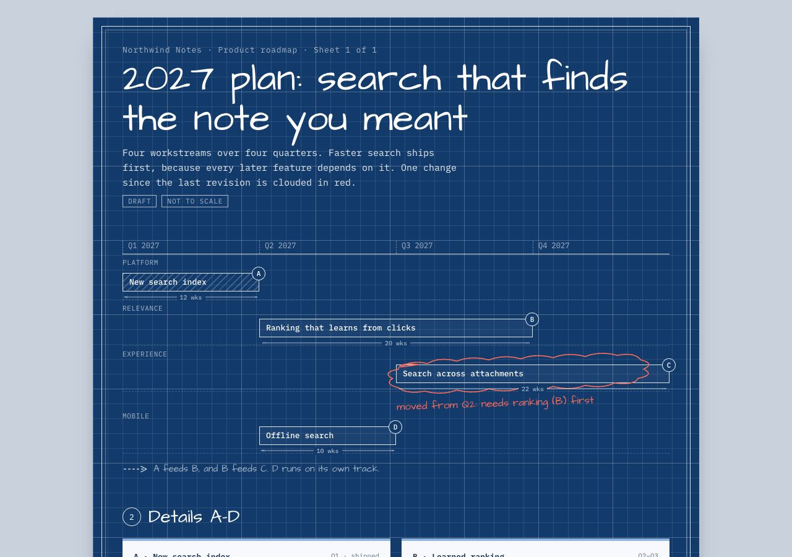

# Medium-first design

A first-principles method for design that doesn't look AI-generated: borrow a real physical
medium, inventory what is in it, rebuild each object in code, and give every mark a job.

[`sketchbook-ui`](../sketchbook-ui) is this method applied to one medium, the designer's sketchbook,
and fully built out. This skill is the general method plus a [library of eight mediums](references/medium-library.md):
sketchbook, blueprint, museum placard, lab notebook, risograph zine, receipt, field journal and
departure board.

**[Gallery of all eight samples](https://rohitjz.github.io/skills/)**

Example: [a product roadmap drawn as an architect's blueprint](examples/blueprint-roadmap/index.html)
(fictional product, illustrative data). It has dimension lines for effort, a title block for
ownership, and a red revision cloud as the one bold move.

| Medium | Job | Sample |
|---|---|---|
| Designer's sketchbook | Milestone | [lets-encrypt-10-years](../sketchbook-ui/examples/lets-encrypt-10-years/index.html) |
| Architect's blueprint | Roadmap | [blueprint-roadmap](examples/blueprint-roadmap/index.html) |
| Museum exhibit | Quarterly review | [museum-qbr](examples/museum-qbr/index.html) |
| Lab notebook | Incident report | [lab-notebook-incident](examples/lab-notebook-incident/index.html) |
| Risograph zine | Launch | [riso-launch](examples/riso-launch/index.html) |
| Receipt and price tags | Pricing | [receipt-pricing](examples/receipt-pricing/index.html) |
| Field journal | Feedback digest | [field-journal-feedback](examples/field-journal-feedback/index.html) |
| Departure board | Release status | [departure-board-status](examples/departure-board-status/index.html) |

All samples except the sketchbook use a fictional product, Northwind Notes, with illustrative data.
