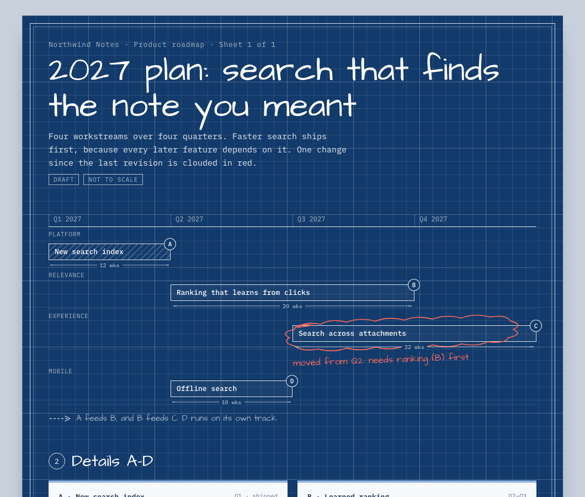

# Medium-first design

A first-principles method for design that doesn't look AI-generated: borrow a real physical
medium, inventory what is in it, rebuild each object in code, and give every mark a job.

[`sketchbook-ui`](../sketchbook-ui) is this method applied to one medium, the designer's sketchbook,
and fully built out. This skill is the general method plus a [library of eight mediums](references/medium-library.md):
sketchbook, blueprint, museum placard, lab notebook, risograph zine, receipt, field journal and
departure board.

Example: [a product roadmap drawn as an architect's blueprint](examples/blueprint-roadmap/index.html)
(fictional product, illustrative data). It has dimension lines for effort, a title block for
ownership, and a red revision cloud as the one bold move.
