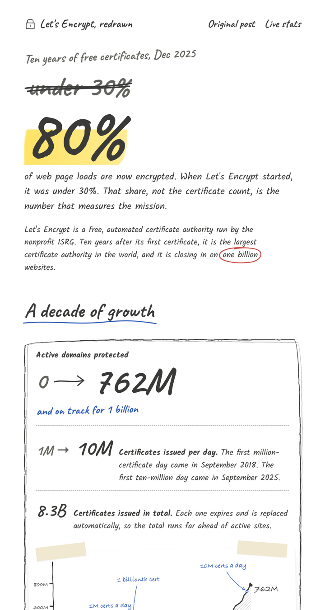

# Sketchbook UI

Make any web page look drawn by hand, without losing a single exact number.

Pencil-wobbly boxes, a highlighter on the number that matters, struck-through "before" values,
circled words, ink arrows, sticky notes, a taped-in pencil chart, and doodled icons. It's an
agent skill for Claude Code and GitHub Copilot, plus a plain CSS and SVG kit you can use by hand.



**Marquee example:** the public post *"10 Years of Let's Encrypt Certificates"*, redrawn.
[Live page](https://rohitjz.github.io/sketchbook-ui/examples/lets-encrypt-10-years/) ·
[Full screenshot](examples/lets-encrypt-10-years/preview.png) ·
[Component kit](https://rohitjz.github.io/sketchbook-ui/examples/kit/)

## Why

Templated pages get skimmed. A page that looks drawn for this one moment gets read. Sketchbook UI
gives a launch, a milestone, a changelog or a team update the warmth of a notebook. Every fact
stays precise and every chart stays honest.

## What's in the kit

| | |
|---|---|
| `assets/sketchbook.css` | Paper, handwriting, marks, pencil boxes, buttons, nav, timeline, sticky notes, the village |
| `assets/symbols.html` | The wobble filter plus reusable doodles: arrow, tick, house, star, lock, strike, underline, circle |
| `assets/page-skeleton.html` | Start any page |
| `assets/newsletter-template.html` | The marquee newsletter layout |
| `scripts/sketch_chart.py` | CSV or XLSX to an xkcd-style chart with hand-lettered callouts |
| `scripts/export_email.py` | Page to email-safe PNG slices, cut only at blank gaps |
| `scripts/inline_assets.py` | Page to one self-contained HTML file |

## Use it as a skill

```bash
git clone https://github.com/rohitjz/sketchbook-ui ~/.claude/skills/sketchbook-ui
# GitHub Copilot: ~/.copilot/skills/sketchbook-ui
```

Then ask, for example:
- *"Make a sketchbook-style landing page for my side project."*
- *"Redraw this blog post as a hand-drawn page."*
- *"Write a sketchbook newsletter celebrating 100K users. Here's the CSV."*

## Use it by hand

```html
<link href="https://fonts.googleapis.com/css2?family=Caveat:wght@500;700&family=Kalam:wght@300;400;700&display=swap" rel="stylesheet">
<link rel="stylesheet" href="assets/sketchbook.css">
<!-- paste assets/symbols.html right after <body> -->
<main class="sheet">
  <div class="kicker">Launch notes, v2</div>
  <h1 class="hand now"><span class="hl">2x faster</span></h1>
  <section class="sk">…</section>
</main>
```

The chart:

```bash
pip install -r requirements.txt
python scripts/sketch_chart.py examples/lets-encrypt-10-years/data.csv --date date \
  --primary active_domains --every 3 \
  --mark "2018-09-15|1M certs a day" --mark "2020-02-27|1 billionth cert" \
  --out chart.png
```

You need Python 3.9 or later. Email export also needs Chrome or Edge for the headless render.

## How it works

- **Wobble:** an irregular `border-radius`, run through an SVG `feTurbulence` +
  `feDisplacementMap` filter, plus a faint offset second stroke.
- **Highlighter:** a skewed gradient behind the bottom of the text.
- **Doodles:** cubic Bézier paths in reusable `<symbol>`s.
- **Chart:** `matplotlib` xkcd mode with a handwriting font, hatched fill and curved callouts.
- **Email:** clients strip web fonts and SVG, so the page ships as image slices instead.

## Credits

The example redraws ["10 Years of Let's Encrypt Certificates"](https://letsencrypt.org/2025/12/09/10-years.html)
(Dec 9, 2025), with data from the public [Let's Encrypt stats](https://letsencrypt.org/stats/).
It is an unofficial design example, not affiliated with Let's Encrypt or ISRG. Let's Encrypt is
a trademark of ISRG. The fonts are [Caveat](https://fonts.google.com/specimen/Caveat) and
[Kalam](https://fonts.google.com/specimen/Kalam), both under the SIL Open Font License.

## License

MIT
